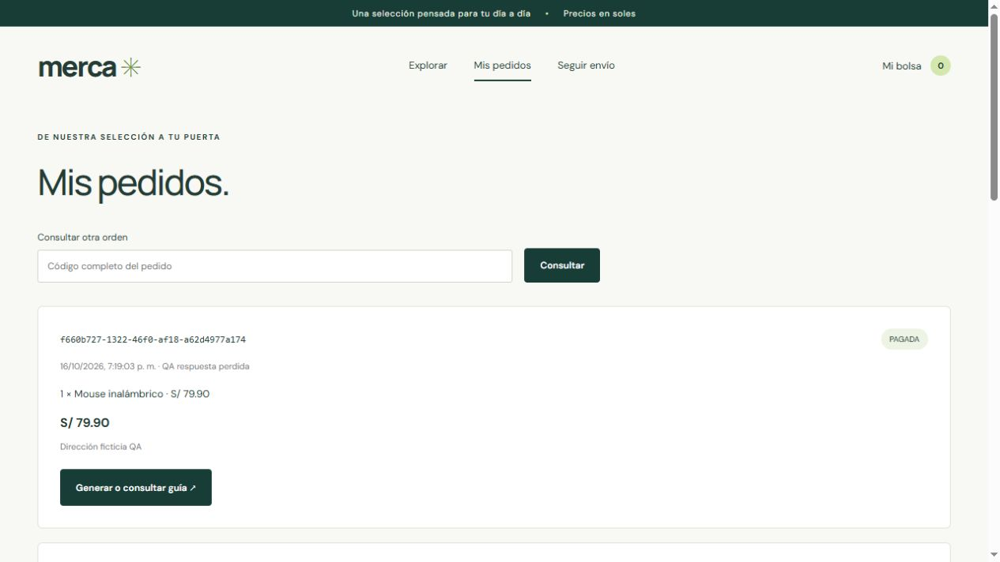

# Revisión funcional de la página

Fecha: 16 de octubre de 2026, America/Lima.

## Resultado

**71 comprobaciones funcionales correctas en la pasada final:** 41 de API y 30 de interfaz. Además se revisó visualmente la adaptación a 375, 768 y 1024 píxeles.

Se reprodujo y corrigió un bloqueo de compras al usar Nginx en el puerto 8088. La compra y su recuperación se comprobaron desde el navegador después de corregirlo.



## Entorno de esta revisión

- Windows, JDK Temurin 25.0.4.1 con destino de compilación Java 21.
- Frontend compilado con TypeScript y Vite, servido por Nginx nativo 1.30.6 en `http://localhost:8088`.
- Gateway y tres servicios Java, con PostgreSQL local en tres bases independientes.
- Navegador integrado basado en Chromium.
- Para la ejecución nativa se adaptaron sólo en archivos temporales el directorio de estáticos, el puerto de escucha y el nombre Docker del gateway a una dirección de loopback.
- Datos ficticios de revisión; algunas órdenes de prueba quedan registradas en las bases locales.

## Fallos encontrados y correcciones

| Hallazgo | Evidencia | Corrección |
| --- | --- | --- |
| Compra y recuperación rechazadas al pasar por Nginx | El navegador recibió HTTP 403 en POST /api/ordenes; el intento quedó pendiente. La misma petición sin Origin podía funcionar, por lo que las llamadas de API solas no detectaban el fallo. | Se conserva el encabezado Host completo, incluido el puerto, con `$http_host`, y se transmite X-Forwarded-Host. El navegador de localhost:8088 vuelve a ser reconocido como el mismo origen. |
| Rutas inexistentes y métodos HTTP incorrectos devolvían 500 | Las comprobaciones de 404/405 fallaron en la primera pasada. | Los tres manejadores de errores conservan el código y las cabeceras de los errores HTTP de Spring, sin convertirlos en un error interno. Se verificaron 404, 405 y 415. |
| Código incompleto en la consulta de pedidos | El campo aceptaba valores como 78 y los enviaba al servidor. | Validación HTML y TypeScript del UUID completo; se desactiva el autocompletado del formulario y se añade una indicación para copiar el código con sus guiones. |
| Un item nulo devolvía 500 en el servicio que estaba ejecutándose | La primera pasada recibió 500; el fuente ya incluía la validación del elemento. | Se recompilaron y reiniciaron los servicios con el fuente actualizado. La repetición devuelve 400. |

El comportamiento del puerto público se contrastó con [la documentación de encabezados del proxy Nginx](https://nginx.org/en/docs/http/ngx_http_proxy_module.html#proxy_set_header) y [la validación CORS de Spring](https://docs.spring.io/spring-framework/reference/web/webflux-cors.html). Las peticiones de un origen no autorizado siguen siendo rechazadas.

**Esto reproduce un fallo real de esta PC, pero no demuestra que el mensaje exacto de la captura del compañero tuviera la misma causa.** Para identificar el fallo de aquella captura hacen falta su petición y respuesta.

## Comprobaciones de API

Las peticiones de la pasada final incluyen el Origin de `http://localhost:8088`, además de usar el proxy de Nginx. Se ejecutaron con datos ficticios y nuevas claves de compra.

| Comprobación | Resultado |
| --- | --- |
| Categorias disponibles | Correcto |
| Catalogo disponible | Correcto |
| Buscar productos | Correcto |
| Producto inexistente | Correcto |
| Metodo HTTP no permitido devuelve 405 | Correcto |
| Ruta inexistente devuelve 404 | Correcto |
| Origen no autorizado rechazado | Correcto |
| Metodo invalido en ordenes devuelve 405 | Correcto |
| Metodo invalido en envios devuelve 405 | Correcto |
| Formato de contenido no admitido devuelve 415 | Correcto |
| JSON mal formado devuelve 400 | Correcto |
| Crear categoria | Correcto |
| Editar categoria | Correcto |
| Categoria duplicada rechazada | Correcto |
| Eliminar categoria vacia | Correcto |
| Crear producto | Correcto |
| Editar producto | Correcto |
| Precio invalido rechazado | Correcto |
| Item nulo rechazado con 400 | Correcto |
| Cantidad cero rechazada | Correcto |
| Productos duplicados rechazados | Correcto |
| Pago rechazado | Correcto |
| Stock restituido una sola vez | Correcto |
| No enviar orden rechazada | Correcto |
| Compra concurrente ultima unidad | Correcto |
| Orden idempotente y total correcto | Correcto |
| UUID con datos distintos rechazado | Correcto |
| Recuperar orden pagada | Correcto |
| Generar guia | Correcto |
| Guia idempotente | Correcto |
| No saltar estados logisticos | Correcto |
| Logistica DESPACHADO | Correcto |
| Logistica EN_TRANSITO | Correcto |
| Logistica ENTREGADO | Correcto |
| Seguimiento y eventos sin duplicados | Correcto |
| Guia inexistente devuelve 404 | Correcto |
| UUID invalido devuelve 400 | Correcto |
| UUID inexistente devuelve 404 | Correcto |
| Reserva multiproducto atomica | Correcto |
| Desactivar producto | Correcto |
| Nginx no publica API interna | Correcto |

## Comprobaciones de interfaz

Se realizaron acciones sobre la página: filtros, introducción de datos, botones, navegación y recargas.

| Comprobación | Resultado |
| --- | --- |
| Catálogo: seis productos | Correcto |
| Filtro de tecnología: tres productos | Correcto |
| Búsqueda sin distinguir mayúsculas | Correcto |
| Búsqueda sin resultados muestra aviso | Correcto |
| Carrito suma unidades | Correcto |
| Total de carrito con varios productos | Correcto |
| Restar unidades actualiza total | Correcto |
| Quitar producto | Correcto |
| Carrito persiste al recargar | Correcto |
| Nombre obligatorio impide envío vacío | Correcto |
| Correo inválido impide envío | Correcto |
| Pago rechazado en navegador conserva bolsa | Correcto |
| Recuperar compra elimina estado pendiente | Correcto |
| Código incompleto se bloquea antes de consultar | Correcto |
| Consulta por código completo | Correcto |
| Compra aprobada vacía carrito | Correcto |
| Compra aprobada aparece en pedidos | Correcto |
| Seguimiento de la guía de compra | Correcto |
| Guía inexistente informa error | Correcto |
| Seguimiento no distingue mayúsculas | Correcto |
| Interrupción previa conserva compra pendiente | Correcto |
| Compra pendiente persiste al recargar | Correcto |
| No modificar carrito con compra incierta | Correcto |
| Recuperación crea la orden original y libera bloqueo | Correcto |
| Respuesta perdida conserva carrito para recuperación | Correcto |
| Recuperar respuesta perdida reconoce orden pagada | Correcto |
| Recuperar orden pagada vacía carrito una vez | Correcto |
| Recuperación muestra una sola orden | Correcto |
| Carrito vacío impide confirmar | Correcto |
| Producto agotado no se puede agregar | Correcto |

## Recuperación ante fallos de comunicación

Se usó un intermediario temporal de diagnóstico, fuera del código del repositorio, para controlar dos situaciones:

1. **La petición no llega al servidor.** El intermediario devolvió 503 antes de crear la orden. Se confirmó que el UUID todavía no existía. Después de recargar la página, Recuperar compra envió los mismos datos y creó una sola orden con el mismo UUID.
2. **La respuesta se pierde después de confirmar.** El servidor registró una orden PAGADA y descontó stock, pero el intermediario cerró la conexión antes de devolver la respuesta al navegador. Recuperar compra reconoció la orden existente, limpió el pendiente y vació el carrito. Se comprobó que el stock sólo se había descontado una vez.

El intermediario se retiró al terminar. La tienda volvió a comunicar Nginx directamente con el gateway.

## Revisión visual y de compilación

- Catálogo revisado a 375, 768 y 1024 píxeles mediante un marco con esos anchos; la revisión visual no mostró solapamientos en las vistas observadas.
- A 375 píxeles también se revisaron bolsa/formulario y pedidos con códigos largos.
- Sin errores JavaScript reportados por el registro de consola consultado en la pasada final.
- Compilación TypeScript/Vite y empaquetado Maven de los cuatro servicios completados.
- Sintaxis de Nginx validada con `nginx -t`.
- Sin carpetas `src/test`, colecciones Postman ni suites de pruebas añadidas al repositorio.

## Cómo aplicar las correcciones en otra computadora

Desde la carpeta del repositorio y con Docker Desktop iniciado:

```powershell
git pull
docker compose up -d --build --wait --wait-timeout 240
```

Si el proyecto se descargó como ZIP, descarga la versión actualizada del repositorio, conserva el archivo local `.env` y reconstruye las imágenes desde esa carpeta. No hace falta eliminar los volúmenes de las bases de datos para aplicar estas correcciones.

## Límites

Esta revisión verifica los flujos y casos enumerados, no todas las combinaciones posibles. No es una auditoría de seguridad, de carga o de accesibilidad completa.

Docker Engine no está instalado en esta PC: se usaron Nginx y Java nativos. Por tanto, la construcción de imágenes Linux, los volúmenes y las redes Docker siguen pendientes de una ejecución con Docker. Los anchos revisados no equivalen a probar teléfonos físicos ni otros motores de navegador.
