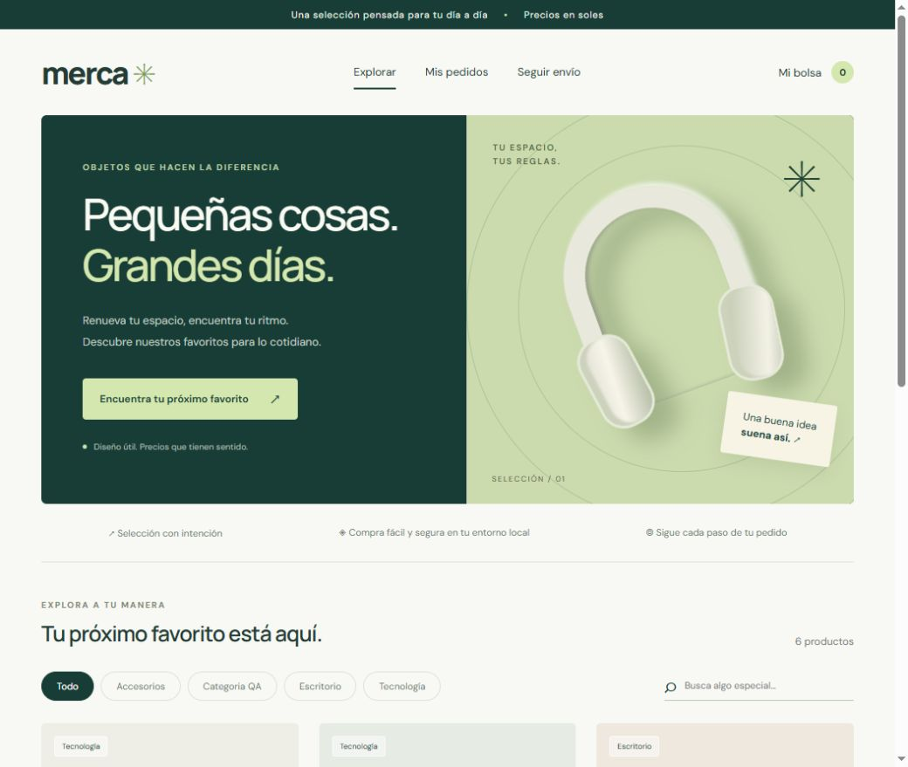
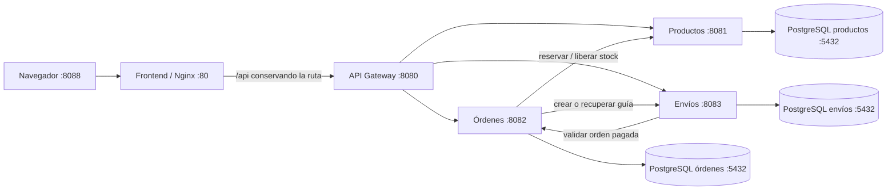

# Merca · E-commerce con microservicios

Aplicación académica con catálogo, categorías, carrito, órdenes, pago simulado y seguimiento de envíos. Usa Java 21, Spring Boot 4.0.5, Spring Cloud Gateway, PostgreSQL y HTML/CSS/TypeScript con Vite.



## Arquitectura y comunicación



Cada dominio tiene una instancia PostgreSQL, una base y un volumen propios, sin claves foráneas entre bases. El gateway publica las rutas `/api`; los endpoints `/internal` son para comunicación entre servicios.

En el despliegue completo, cada base está en una red interna diferente junto a su servicio. Los servicios HTTP comparten la red de aplicación. Sólo Nginx y el gateway publican puertos al equipo, ligados a `127.0.0.1`.

Los cinco Dockerfiles compilan en una etapa y ejecutan en otra: Maven/JDK → JRE para Java y Node/Vite → Nginx para el frontend. Las imágenes Java usan un usuario sin privilegios. Las comprobaciones de salud y `depends_on: condition: service_healthy` ordenan el arranque. Referencias: [builds multietapa](https://docs.docker.com/build/building/multi-stage/) y [orden de inicio](https://docs.docker.com/compose/how-tos/startup-order/).

## Estructura de directorios

```text
/
├── docker-compose.yml              # Ecosistema completo, proyecto "merca"
├── .env.example                    # Plantilla sin contraseñas
├── README.md
├── Base_de_Datos/
│   ├── docker-compose.yml          # Sólo BD, proyecto "merca-bd-dev"
│   ├── init_productos.sql
│   ├── init_ordenes.sql
│   └── init_envios.sql
├── Backend/
│   ├── pom.xml
│   ├── mvnw / mvnw.cmd / .mvn/
│   ├── .dockerignore
│   ├── VERIFICACION.md
│   ├── api-gateway/                 # Dockerfile, pom.xml, src/main/
│   ├── servicio-productos/          # Dockerfile, pom.xml, src/main/
│   ├── servicio-ordenes/            # Dockerfile, pom.xml, src/main/
│   └── servicio-envios/             # Dockerfile, pom.xml, src/main/
└── Frontend/
    ├── Dockerfile
    ├── .dockerignore
    ├── nginx.conf
    ├── package.json / package-lock.json
    ├── tsconfig.json / vite.config.ts
    └── src/
        ├── index.html
        ├── css/
        └── ts/
```

Se conservan las tres carpetas principales; Compose y la plantilla de entorno son archivos. No se incluyen Postman, dependencias de testing ni carpetas de pruebas.

## Requisitos previos

| Herramienta | Desarrollo local (A) | Ecosistema completo (B) |
| --- | --- | --- |
| Docker Engine con BuildKit o Docker Desktop en modo de contenedores Linux | Sí, para las bases | Sí |
| Docker Compose 2.20 o posterior | Sí | Sí |
| JDK 21 o posterior, con `JAVA_HOME` configurado | Sí | Incluido en el build |
| Node.js 22.12 o posterior y npm | Sí | Node 24 incluido en el build |
| Maven | Maven Wrapper descarga 3.9.11 | Maven 3.9.11 incluido en el build |

Se necesita acceso a Internet para obtener imágenes y dependencias. Docker Desktop debe estar iniciado. En Windows usa contenedores Linux. Los comandos siguientes se ejecutan desde la raíz del repositorio en PowerShell.

```powershell
docker version
docker compose version
```

Para la opción A, comprueba también `java -version`, `node --version` y `npm --version`. No hace falta instalar PostgreSQL ni `psql` en el equipo.

## Preparación común

Si aún no tienes el repositorio:

```powershell
git clone https://github.com/MACOABC/ecommerce-microservicios.git
cd ecommerce-microservicios
```

Copia la plantilla y completa una contraseña diferente para cada base:

```powershell
Copy-Item .env.example .env
notepad .env
```

En Linux/macOS usa `cp .env.example .env` y tu editor. Los tres valores `*_DB_PASSWORD` son obligatorios y vienen vacíos. `.env` está ignorado por Git y excluido de los contextos de build. Si un valor contiene `$` o `#`, escríbelo entre comillas simples.

Compose pasa las contraseñas a cada contenedor en ejecución; no se incorporan a las imágenes. Consulta la [interpolación de variables](https://docs.docker.com/compose/how-tos/environment-variables/variable-interpolation/).

## Opción A · Desarrollo local con las bases en Docker

### 1. Iniciar las tres bases

```powershell
docker compose --env-file .env -f Base_de_Datos/docker-compose.yml config --quiet
docker compose --env-file .env -f Base_de_Datos/docker-compose.yml up -d --wait --wait-timeout 120
docker compose --env-file .env -f Base_de_Datos/docker-compose.yml ps
```

Se ejecuta cada SQL automáticamente al iniciar un volumen vacío:

| Base / usuario | Host | Puerto del equipo |
| --- | --- | --- |
| `ecommerce_productos` | localhost | 15432 |
| `ecommerce_ordenes` | localhost | 25432 |
| `ecommerce_envios` | localhost | 35432 |

Los puertos se pueden cambiar en `.env`. Cada contenedor escucha internamente en 5432.

### 2. Compilar la aplicación

```powershell
.\Backend\mvnw.cmd -f Backend/pom.xml package
npm --prefix Frontend ci
npm --prefix Frontend run build
```

En Linux/macOS usa `sh Backend/mvnw -f Backend/pom.xml package`. Maven genera un JAR por servicio. Para compilar un módulo concreto, añade `-pl servicio-productos -am` al comando con el POM de Backend.

### 3. Ejecutar cada servicio en una terminal distinta

Abre todas las terminales desde la raíz. Introduce la misma contraseña que configuraste para esa base en `.env`.

**Terminal 1 · Productos**

```powershell
$env:DB_URL = 'jdbc:postgresql://localhost:15432/ecommerce_productos'
$env:DB_USER = 'ecommerce_productos'
$env:DB_PASSWORD = [System.Net.NetworkCredential]::new('', (Read-Host 'Contraseña de productos' -AsSecureString)).Password
java -jar Backend/servicio-productos/target/servicio-productos-1.0.0.jar
```

**Terminal 2 · Órdenes**

```powershell
$env:DB_URL = 'jdbc:postgresql://localhost:25432/ecommerce_ordenes'
$env:DB_USER = 'ecommerce_ordenes'
$env:DB_PASSWORD = [System.Net.NetworkCredential]::new('', (Read-Host 'Contraseña de órdenes' -AsSecureString)).Password
java -jar Backend/servicio-ordenes/target/servicio-ordenes-1.0.0.jar
```

**Terminal 3 · Envíos**

```powershell
$env:DB_URL = 'jdbc:postgresql://localhost:35432/ecommerce_envios'
$env:DB_USER = 'ecommerce_envios'
$env:DB_PASSWORD = [System.Net.NetworkCredential]::new('', (Read-Host 'Contraseña de envíos' -AsSecureString)).Password
java -jar Backend/servicio-envios/target/servicio-envios-1.0.0.jar
```

**Terminal 4 · Gateway**

```powershell
java -jar Backend/api-gateway/target/api-gateway-1.0.0.jar
```

**Terminal 5 · Frontend**

```powershell
npm --prefix Frontend run dev
```

Abre [http://localhost:5173](http://localhost:5173). Vite redirige `/api` al gateway local en 8080. La API también está disponible en [http://localhost:8080/api/productos](http://localhost:8080/api/productos). El preview de Vite usa el mismo proxy.

En el IDE, abre `Backend/pom.xml` como proyecto Maven, configura JDK 21 o posterior y ejecuta la clase `Application` de cada módulo con las mismas variables de entorno.

Spring no carga `.env` automáticamente. Las variables de una terminal no se comparten con las demás. Si cambias los puertos de las bases, actualiza las `DB_URL`; si cambias el puerto local del gateway, ajusta los proxies de `Frontend/vite.config.ts`.

### 4. Detener el entorno

Detén Java y Vite con Ctrl+C en sus terminales; luego:

```powershell
docker compose --env-file .env -f Base_de_Datos/docker-compose.yml down
```

Los volúmenes conservan sus datos.

## Opción B · Despliegue completo con Docker Compose

Detén los servicios locales para liberar el puerto del gateway. Después de completar `.env`, todo el ecosistema se construye e inicia con:

```powershell
docker compose up -d
```

La primera ejecución construye las imágenes que aún no existen. Para construir explícitamente, actualizar las imágenes base y esperar a que los servicios estén saludables:

```powershell
docker compose config --quiet
docker compose build --pull
docker compose up -d --wait --wait-timeout 240
docker compose ps
```

Compose prepara ocho servicios: tres PostgreSQL, tres servicios de dominio, gateway y frontend. Las bases se inicializan antes que Java. Órdenes espera a productos y envíos espera a órdenes. El gateway espera a los tres servicios y Nginx espera al gateway.

| Recurso | Dirección por defecto |
| --- | --- |
| Tienda Nginx | [http://localhost:8088](http://localhost:8088) |
| Catálogo mediante Nginx | [http://localhost:8088/api/productos](http://localhost:8088/api/productos) |
| Gateway directo | [http://localhost:8080/api/productos](http://localhost:8080/api/productos) |
| Salud de Nginx | [http://localhost:8088/health](http://localhost:8088/health) |
| Salud del gateway | [http://localhost:8080/actuator/health](http://localhost:8080/actuator/health) |

Las bases y los tres servicios de dominio no publican puertos al equipo en este modo. Nginx conserva `/api` y los parámetros de consulta; no se usa Vite como servidor. El proxy vuelve a resolver el nombre del gateway mediante DNS de Docker si cambia su IP.

### Construcción individual y actualización

El contexto de build de cada servicio Java es `Backend/`, porque Maven necesita el POM padre y los POM de sus módulos:

```powershell
docker build -f Backend/api-gateway/Dockerfile -t merca-gateway Backend
docker build -f Backend/servicio-productos/Dockerfile -t merca-productos Backend
docker build -f Backend/servicio-ordenes/Dockerfile -t merca-ordenes Backend
docker build -f Backend/servicio-envios/Dockerfile -t merca-envios Backend
docker build -t merca-frontend Frontend
```

Para actualizar el código y reconstruir las imágenes administradas por Compose:

```powershell
git pull
docker compose up -d --build --wait --wait-timeout 240
```

### Logs, inspección y parada

```powershell
docker compose logs --tail 100 api-gateway servicio-ordenes
docker compose logs -f frontend
docker compose exec db-productos psql -U ecommerce_productos -d ecommerce_productos -c "\dt"
docker compose down
```

Ctrl+C detiene el seguimiento de logs. `down` detiene los servicios y conserva los datos.

## Datos, volúmenes e inicialización

Los proyectos Compose `merca-bd-dev` y `merca` tienen volúmenes independientes: las compras de un modo no aparecen en el otro.

Los SQL montados en `/docker-entrypoint-initdb.d/` se ejecutan sólo cuando el volumen está vacío, según la [imagen oficial de PostgreSQL](https://hub.docker.com/_/postgres). Modificar un script o la contraseña de `.env` no cambia una base ya existente. Los cambios de esquema necesitan SQL de migración; para cambiar una contraseña existente, actualízala primero en PostgreSQL y luego en la configuración.

Para **eliminar deliberadamente todos los datos del modo B** y cargar de nuevo los ejemplos:

```powershell
docker compose down --volumes
docker compose up -d --wait --wait-timeout 240
```

Para restablecer sólo el modo A, añade `--env-file .env -f Base_de_Datos/docker-compose.yml` a ambos comandos. El borrado afecta a los volúmenes del proyecto seleccionado.

Los datos iniciales incluyen seis productos, tres categorías y la guía histórica `ENV-DEMO-001`. Su orden de ejemplo no descuenta el inventario inicial.

## Variables de entorno y configuración

### Variables de Compose en `.env`

| Variable | Valor por defecto / uso |
| --- | --- |
| `PRODUCTOS_DB_PASSWORD` | Obligatoria; contraseña de productos |
| `ORDENES_DB_PASSWORD` | Obligatoria; contraseña de órdenes |
| `ENVIOS_DB_PASSWORD` | Obligatoria; contraseña de envíos |
| `FRONTEND_PORT` | 8088; puerto del equipo para Nginx, modo B |
| `GATEWAY_PORT` | 8080; puerto del equipo para gateway, modo B |
| `PRODUCTOS_DB_PORT` | 15432; puerto del equipo de BD productos, modo A |
| `ORDENES_DB_PORT` | 25432; puerto del equipo de BD órdenes, modo A |
| `ENVIOS_DB_PORT` | 35432; puerto del equipo de BD envíos, modo A |

Las bases y los roles se llaman `ecommerce_productos`, `ecommerce_ordenes` y `ecommerce_envios`. Compose configura `POSTGRES_DB`, `POSTGRES_USER` y `POSTGRES_PASSWORD` para cada instancia.

### Variables de los servicios Java

| Variable | Desarrollo local | Contenedores |
| --- | --- | --- |
| `DB_URL` | JDBC a localhost:15432 / 25432 / 35432 | JDBC a db-productos / db-ordenes / db-envios:5432 |
| `DB_USER` | `ecommerce_<dominio>` | `ecommerce_<dominio>` |
| `DB_PASSWORD` | Introducida en cada terminal o IDE | Contraseña del dominio de `.env` |
| `BIND_ADDRESS` | 127.0.0.1 | 0.0.0.0, definido en los Dockerfiles |
| `PORT` | 8080 gateway; 8081 productos; 8082 órdenes; 8083 envíos | Mismos puertos internos |
| `PRODUCTOS_URL` | http://localhost:8081 | http://servicio-productos:8081 |
| `ORDENES_URL` | http://localhost:8082 | http://servicio-ordenes:8082 |
| `ENVIOS_URL` | http://localhost:8083 | http://servicio-envios:8083 |
| `FRONTEND_ORIGIN` | http://localhost:5173 | El proxy de mismo origen no requiere cambiarlo |

El gateway no necesita base de datos. Las URL remotas se sobrescriben donde se consumen. El navegador usa rutas relativas `/api`, por lo que cambiar `FRONTEND_PORT` no requiere recompilar. `GATEWAY_PORT` cambia sólo el puerto del equipo, no el destino interno de Nginx.

Las propiedades Java sin variables conservan localhost:5432 como valor JDBC para una instalación manual de PostgreSQL. En el modo A se sobrescriben con los puertos de la tabla anterior.

## Uso

1. Explora y filtra el catálogo, agrega productos y ajusta cantidades en tu bolsa.
2. Ingresa nombre, correo y dirección de ejemplo. Elige aprobar o rechazar el pago simulado.
3. Una orden aprobada permite generar su guía. Si logística no responde, la orden permanece pagada y la guía se puede generar más tarde desde Mis pedidos.
4. Consulta el seguimiento con la guía. El historial muestra cada cambio de estado.
5. El carrito, los identificadores de órdenes y la compra pendiente se guardan en el navegador. Para consultar una orden desde otro navegador, ingresa su UUID en Mis pedidos.

El pago es una simulación determinista, sin proveedor bancario, cargos reales ni datos de tarjeta.

## API pública a través del gateway

Base en modo B: `http://localhost:8088` mediante Nginx, o `http://localhost:8080` directamente mediante el gateway.

| Método | Ruta | Acción |
| --- | --- | --- |
| GET | `/api/categorias` | Listar categorías |
| POST | `/api/categorias` | Crear `{ "nombre": "Hogar" }` |
| PUT / DELETE | `/api/categorias/{id}` | Editar / eliminar; no se elimina una categoría con productos |
| GET | `/api/productos?q=mouse&categoria=1` | Buscar productos activos |
| GET | `/api/productos/{id}` | Consultar producto |
| POST | `/api/productos` | Crear producto |
| PUT / DELETE | `/api/productos/{id}` | Editar / desactivar producto |
| POST | `/api/ordenes` | Crear y procesar compra |
| GET | `/api/ordenes/{uuid}` | Consultar orden y detalle |
| POST | `/api/ordenes/{uuid}/reintentar` | Recuperar una operación incompleta |
| POST | `/api/ordenes/{uuid}/envio` | Crear o recuperar la guía |
| GET | `/api/envios/seguimiento/{guia}` | Consultar envío y eventos |
| PATCH | `/api/envios/{uuid}/estado` | Avanzar estado logístico |

Producto para POST/PUT:

```json
{
  "nombre": "Soporte para laptop",
  "descripcion": "Aluminio, altura regulable",
  "precio": 119.90,
  "stock": 10,
  "categoriaId": 2
}
```

Compra para POST (genera un UUID nuevo para cada compra distinta):

```json
{
  "id": "1bc3b97b-81d8-4f4a-88d6-cabdebd781a1",
  "cliente": "Cliente de ejemplo",
  "email": "cliente@example.com",
  "direccion": "Av. Ejemplo 123, Lima",
  "aprobarPago": true,
  "items": [{ "productoId": 1, "cantidad": 2 }]
}
```

Los precios y el total siempre se calculan en el servidor. El cuerpo no acepta un precio del cliente. Las cantidades son de 1 a 999 por producto y se admiten hasta 100 productos distintos por compra.

Cambio logístico: `{ "estado": "DESPACHADO" }`. Sólo se permiten transiciones secuenciales:

```text
PREPARANDO → DESPACHADO → EN_TRANSITO → ENTREGADO
```

Repetir el mismo estado no agrega un evento duplicado. La gestión de catálogo y logística se realiza por la API; la interfaz está orientada al comprador.

Errores de dominio: JSON con `timestamp`, `status`, `message` y `path`. Los servicios distinguen validación (400), recurso inexistente (404), conflicto (409) y fallos remotos (502/503). Los errores internos no exponen SQL ni credenciales.

## Consistencia y recuperación

- La intención de compra se confirma en la base de órdenes antes de llamar al catálogo.
- Una reserva descuenta todos sus productos en una única transacción del catálogo. Los productos se bloquean por ID para serializar compras concurrentes.
- El UUID de la orden identifica también su reserva. Repetir una compra o un reintento no vuelve a descontar inventario. Reutilizar el UUID con otros datos se rechaza.
- Un pago rechazado libera toda la reserva una sola vez.
- Si una respuesta se pierde, el navegador conserva la compra pendiente y recupera el resultado usando el mismo UUID. No debe sustituirse por una compra nueva mientras el resultado sea incierto.
- Los envíos son únicos por orden; reintentar su creación recupera la misma guía.
- Son transacciones locales coordinadas mediante operaciones HTTP idempotentes. No se promete una transacción distribuida: una orden CREADA puede conservar una reserva si el proceso cae después de reservar. Se recupera con `/reintentar`; no hay expiración automática ni proceso de conciliación.

## Diagnóstico

| Situación | Acción |
| --- | --- |
| Compose pide una contraseña | Completa los tres valores obligatorios de `.env` |
| Puerto ocupado | Detén el proceso que usa ese puerto o cambia el puerto publicado |
| Java local no conecta a la BD | Revisa puerto de modo A, `DB_URL`, usuario y contraseña por terminal |
| Contenedor `unhealthy` | Consulta `docker compose logs --tail 100 <servicio>` y sus dependencias |
| El primer arranque tarda | Espera a descargar imágenes, compilar dependencias e inicializar PostgreSQL |
| Nginx devuelve 502 | Revisa los logs del gateway y de sus servicios |
| Se sigue viendo código anterior | Ejecuta `docker compose up -d --build --wait --wait-timeout 240` |
| SQL o contraseña nuevos no se aplican | Revisa la sección de volúmenes; la base ya puede existir |

## Alcance académico

En ejecución local los servicios escuchan en loopback; en Docker se comunican por sus redes y sólo se publican Nginx y el gateway en loopback. No se incluye autenticación, autorización de administración ni separación de compradores; conocer el UUID permite consultar la orden. CORS no sustituye controles de acceso. Usa información ficticia y un entorno local. Antes de exponer esta aplicación a Internet se necesitan autenticación, permisos, protección de datos y conciliación operativa.

## Verificación

Consulta [Backend/VERIFICACION.md](Backend/VERIFICACION.md) para los resultados de compilación, las verificaciones locales y la validación estática de Compose. La construcción y ejecución de los contenedores requiere un Docker Engine activo y queda pendiente en este equipo. No se incluyen suites de pruebas.

La [revisión integral de la página](Backend/REVISION_PAGINA.md) documenta 71 comprobaciones funcionales, las recuperaciones de compra simuladas y la corrección del encabezado Host de Nginx para comprar a través del puerto 8088.
