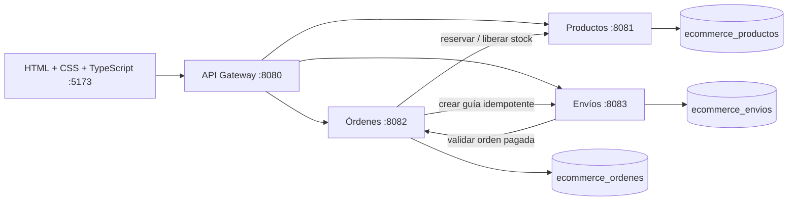

# Merca · E-commerce con microservicios

Proyecto académico en Java 21, Spring Boot 4.0.5, Spring Cloud Gateway, PostgreSQL y TypeScript sin framework de interfaz. Incluye catálogo, categorías, carrito local, órdenes, pago simulado y seguimiento de envíos.


La arquitectura toma como guía [NexusMicroservicios de Henry Wong](https://github.com/hwongu/NexusMicroservicios): punto de entrada único, servicios por dominio, comunicación HTTP y manejo central de errores. La implementación de Merca es original, usa Spring JDBC con SQL explícito y adapta esos patrones al comercio electrónico.

## Organización

```text
Base_de_Datos/
  init_productos.sql
  init_ordenes.sql
  init_envios.sql
Backend/
  pom.xml
  mvnw / mvnw.cmd / .mvn/
  api-gateway/
  servicio-productos/
  servicio-ordenes/
  servicio-envios/
Frontend/
  package.json
  package-lock.json
  tsconfig.json
  vite.config.ts
  src/
    index.html
    css/styles.css
    ts/
```

Cada servicio contiene su configuración y un único paquete Java con controladores, lógica de dominio, DTOs mediante records y manejo de errores. Sólo existen tres carpetas principales. No se incluyen contenedores, infraestructura de despliegue, Postman, dependencias de testing ni carpetas de pruebas.

## Arquitectura



Las tres bases pueden residir en una misma instalación local de PostgreSQL. Cada una tiene su propio usuario propietario y sus tablas; no hay claves foráneas entre bases. El gateway sólo publica rutas `/api`; las operaciones `/internal` son para comunicación entre servicios.

## Requisitos

- JDK 21 o posterior, con `JAVA_HOME` apuntando al JDK. Java 8 no es compatible.
- PostgreSQL 17 o posterior con `psql` disponible.
- Node.js 22.12 o posterior y npm.
- Acceso a Internet para descargar dependencias. Maven Wrapper descarga Maven 3.9.11 en el primer uso.

Los comandos siguientes se ejecutan desde la raíz del repositorio en PowerShell.

## 1. Crear e inicializar las bases

Entra como administrador local:

```powershell
psql -U postgres -d postgres
```

Dentro de `psql`, crea los roles y asigna una contraseña distinta a cada uno mediante el prompt interactivo:

```sql
CREATE ROLE ecommerce_productos LOGIN;
\password ecommerce_productos
CREATE ROLE ecommerce_ordenes LOGIN;
\password ecommerce_ordenes
CREATE ROLE ecommerce_envios LOGIN;
\password ecommerce_envios
CREATE DATABASE ecommerce_productos OWNER ecommerce_productos;
CREATE DATABASE ecommerce_ordenes OWNER ecommerce_ordenes;
CREATE DATABASE ecommerce_envios OWNER ecommerce_envios;
\q
```

Inicializa cada base una sola vez. Los scripts fallan si ya existen las tablas para evitar borrar datos accidentalmente:

```powershell
psql -h localhost -U ecommerce_productos -d ecommerce_productos -v ON_ERROR_STOP=1 -f Base_de_Datos/init_productos.sql
psql -h localhost -U ecommerce_ordenes -d ecommerce_ordenes -v ON_ERROR_STOP=1 -f Base_de_Datos/init_ordenes.sql
psql -h localhost -U ecommerce_envios -d ecommerce_envios -v ON_ERROR_STOP=1 -f Base_de_Datos/init_envios.sql
```

El catálogo incluye seis productos y tres categorías. La orden histórica de ejemplo está asociada a la guía `ENV-DEMO-001`; sus datos no descuentan el stock inicial.

## 2. Compilar

```powershell
.\Backend\mvnw.cmd -f Backend/pom.xml package
npm --prefix Frontend ci
npm --prefix Frontend run build
```

En Linux/macOS, usa `sh Backend/mvnw -f Backend/pom.xml package`. Cada servicio se puede compilar por separado con `-pl servicio-productos -am` desde el POM de Backend.

## 3. Iniciar los servicios

Abre una terminal por servicio desde la raíz. Define `DB_PASSWORD` en cada terminal con la contraseña del rol correspondiente. Para ingresarla sin mostrarla en pantalla:

```powershell
$env:DB_PASSWORD = [System.Net.NetworkCredential]::new('', (Read-Host 'Contraseña de la base' -AsSecureString)).Password
```

**Terminal 1 — Productos**

```powershell
java -jar Backend/servicio-productos/target/servicio-productos-1.0.0.jar
```

**Terminal 2 — Órdenes** (establece su propia `DB_PASSWORD`)

```powershell
java -jar Backend/servicio-ordenes/target/servicio-ordenes-1.0.0.jar
```

**Terminal 3 — Envíos** (establece su propia `DB_PASSWORD`)

```powershell
java -jar Backend/servicio-envios/target/servicio-envios-1.0.0.jar
```

**Terminal 4 — Gateway** (no necesita base de datos)

```powershell
java -jar Backend/api-gateway/target/api-gateway-1.0.0.jar
```

**Terminal 5 — Frontend**

```powershell
npm --prefix Frontend run dev
```

Abre [http://localhost:5173](http://localhost:5173). Vite redirige `/api` al gateway en desarrollo y en `npm run preview`. El contenido de `dist` requiere un servidor con el mismo proxy `/api` para servirlo fuera de Vite.

Cada servicio expone `/actuator/health` en su propio puerto. Detén cada terminal con Ctrl+C.

## Configuración

| Variable | Valor por defecto / propósito |
| --- | --- |
| `DB_URL` | `jdbc:postgresql://localhost:5432/ecommerce_productos` (o `ordenes`, `envios` según el servicio) |
| `DB_USER` | `ecommerce_productos`, `ecommerce_ordenes` o `ecommerce_envios` |
| `DB_PASSWORD` | Obligatoria para cada servicio con base de datos |
| `PORT` | 8080, 8081, 8082 o 8083 según el servicio |
| `BIND_ADDRESS` | `127.0.0.1` |
| `PRODUCTOS_URL` | `http://localhost:8081` |
| `ORDENES_URL` | `http://localhost:8082` |
| `ENVIOS_URL` | `http://localhost:8083` |
| `FRONTEND_ORIGIN` | `http://localhost:5173`, CORS del gateway |

Las contraseñas se leen del entorno. Spring no carga automáticamente archivos `.env`. Las variables de una terminal no se comparten con las demás. Si cambias puertos del gateway o del frontend, ajusta también los proxies de `Frontend/vite.config.ts`.

## Uso

1. Explora y filtra el catálogo, agrega productos y ajusta cantidades en tu bolsa.
2. Ingresa nombre, correo y dirección de ejemplo. Elige aprobar o rechazar el pago simulado.
3. Una orden aprobada permite generar su guía. Si logística no responde, la orden permanece pagada y la guía se puede generar más tarde desde Mis pedidos.
4. Consulta el seguimiento con la guía. El historial muestra cada cambio de estado.
5. El carrito, los identificadores de órdenes y la compra pendiente se guardan en el navegador. Para consultar una orden desde otro navegador, ingresa su UUID en Mis pedidos.

El pago es una simulación determinista, sin proveedor bancario, cargos reales ni datos de tarjeta.

## API pública a través del gateway

Base: `http://localhost:8080`.

| Método | Ruta | Acción |
| --- | --- | --- |
| GET | `/api/categorias` | Listar categorías |
| POST | `/api/categorias` | Crear `{ "nombre": "Hogar" }` |
| PUT / DELETE | `/api/categorias/{id}` | Editar / eliminar; no se elimina una categoría con productos |
| GET | `/api/productos?q=mouse&categoria=1` | Buscar productos activos |
| GET | `/api/productos/{id}` | Consultar producto |
| POST | `/api/productos` | Crear producto |
| PUT / DELETE | `/api/productos/{id}` | Editar / desactivar producto |
| POST | `/api/ordenes` | Crear y procesar compra |
| GET | `/api/ordenes/{uuid}` | Consultar orden y detalle |
| POST | `/api/ordenes/{uuid}/reintentar` | Recuperar una operación incompleta |
| POST | `/api/ordenes/{uuid}/envio` | Crear o recuperar la guía |
| GET | `/api/envios/seguimiento/{guia}` | Consultar envío y eventos |
| PATCH | `/api/envios/{uuid}/estado` | Avanzar estado logístico |

Producto para POST/PUT:

```json
{
  "nombre": "Soporte para laptop",
  "descripcion": "Aluminio, altura regulable",
  "precio": 119.90,
  "stock": 10,
  "categoriaId": 2
}
```

Compra para POST (genera un UUID nuevo para cada compra distinta):

```json
{
  "id": "1bc3b97b-81d8-4f4a-88d6-cabdebd781a1",
  "cliente": "Cliente de ejemplo",
  "email": "cliente@example.com",
  "direccion": "Av. Ejemplo 123, Lima",
  "aprobarPago": true,
  "items": [{ "productoId": 1, "cantidad": 2 }]
}
```

Los precios y el total siempre se calculan en el servidor. El cuerpo no acepta un precio del cliente. Las cantidades son de 1 a 999 por producto y se admiten hasta 100 productos distintos por compra.

Cambio logístico: `{ "estado": "DESPACHADO" }`. Sólo se permiten transiciones secuenciales:

```text
PREPARANDO → DESPACHADO → EN_TRANSITO → ENTREGADO
```

Repetir el mismo estado no agrega un evento duplicado. La gestión de catálogo y logística se realiza por la API; la interfaz está orientada al comprador.

Errores de dominio: JSON con `timestamp`, `status`, `message` y `path`. Los servicios distinguen validación (400), recurso inexistente (404), conflicto (409) y fallos remotos (502/503). Los errores internos no exponen SQL ni credenciales.

## Consistencia y recuperación

- La intención de compra se confirma en la base de órdenes antes de llamar al catálogo.
- Una reserva descuenta todos sus productos en una única transacción del catálogo. Los productos se bloquean por ID para serializar compras concurrentes.
- El UUID de la orden identifica también su reserva. Repetir una compra o un reintento no vuelve a descontar inventario. Reutilizar el UUID con otros datos se rechaza.
- Un pago rechazado libera toda la reserva una sola vez.
- Si una respuesta se pierde, el navegador conserva la compra pendiente y recupera el resultado usando el mismo UUID. No debe sustituirse por una compra nueva mientras el resultado sea incierto.
- Los envíos son únicos por orden; reintentar su creación recupera la misma guía.
- Son transacciones locales coordinadas mediante operaciones HTTP idempotentes. No se promete una transacción distribuida: una orden CREADA puede conservar una reserva si el proceso cae después de reservar. Se recupera con `/reintentar`; no hay expiración automática ni proceso de conciliación.

## Alcance académico

Los servicios escuchan en loopback por defecto. No se incluye autenticación, autorización de administración ni separación de compradores; conocer el UUID permite consultar la orden. CORS no sustituye controles de acceso. Usa información ficticia y un entorno local. Antes de exponer esta aplicación a Internet se necesitan autenticación, permisos, protección de datos y conciliación operativa.

## Verificación

Consulta [Backend/VERIFICACION.md](Backend/VERIFICACION.md) para los resultados de compilación y verificaciones manuales realizadas. No se incluyen suites de pruebas.
